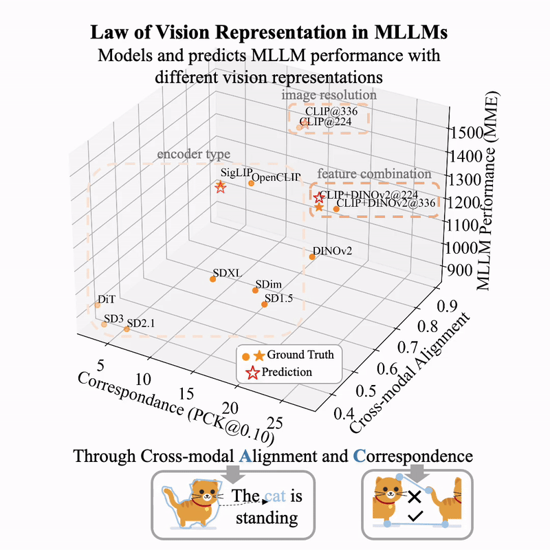

#  Law of Vision Representation in MLLMs

[arXiv](https://arxiv.org/abs/2408.16357) / [HuggingFace](https://huggingface.co/papers/2408.16357) / [More Thoughts (Blog in English)](https://huggingface.co/blog/Borise/law-vision-representation-in-mllms) / [More Thoughts (Blog in Chinese)](https://zhuanlan.zhihu.com/p/717297186)

<div align="center">
  
</div>


## Updates
- [2025/10/06] 🎉 Accepted by COLM 2025! Updated A score calculation with improved implementation.
- [2024/09/01] We released the checkpoints of MLLMs on 13 vision representations.
- [2024/08/29] We introduce the Law of Vision Representation in MLLMs and AC Policy.

## Contents
- [Clone This Repository](#clone-this-repository)
- [Train LLaVA with Custom Vision Representation](#train-llava-with-custom-vision-representation)
- [Pretrained Weights](#pretrained-weights)
- [Evaluations](#evaluations)
- [AC Compute](#ac-compute)
- [AC Policy](#ac-policy)
- [Note](#note)
- [Citation](#citation)
- [Acknowledgement](#acknowledgement)

## Clone This Repository
```bash
git clone https://github.com/bronyayang/Law_of_Vision_Representation_in_MLLMs.git
cd Law_of_Vision_Representation_in_MLLMs
```

## Train LLaVA with Custom Vision Representation

### 1. Install the LLaVA Environment: Ensure that the environment is compatible with your custom vision module

```Shell
conda create -n ac_llava python=3.10 -y
conda activate ac_llava
pip install --upgrade pip
bash run.sh
```

This training environment has been tested on **CUDA 12.2** and is compatible with all the encoders mentioned in the paper, **except for OpenCLIP** (refer to [environment record](https://github.com/bronyayang/Law_of_Vision_Representation_in_MLLMs/blob/master/version_rec.text) for details on OpenCLIP compatibility).

To run SD3 vision representation, you'll need to install the diffusers package from the repository. Follow these steps:

```Shell
cd diffusers
pip install -e .
```

#### **Important Note:**
To accommodate diffusion model encoders, this environment includes the `diffusers`, `xformers`, and `transformers` packages. However, these packages may conflict with each other. **It is strongly advised to modify [pyproject.toml](https://github.com/bronyayang/Law_of_Vision_Representation_in_MLLMs/blob/master/pyproject.toml) and install only the packages required for your custom vision encoder, rather than all 10 encoders simultaneously.**

### 2. Stage 1 Training

**Prepare LLaVA Stage 1 Data:** Follow the instructions in [LLaVA's tutorial](https://github.com/haotian-liu/LLaVA/tree/main?tab=readme-ov-file#pretrain-feature-alignment) to prepare the data for Stage 1 training.

**Start Training:**
Use the following command to start training:

```Shell
bash llava/scripts/v1_5/train/pretrain.sh
```

However, before running the command, ensure that you modify the following parameters in the script:

- `--data_path`
- `--image_folder`
- `--output_dir`
- `--vision_tower`

**Available Vision Towers:**

- `openai/clip-vit-large-patch14`
- `openai/clip-vit-large-patch14-336`
- `laion/CLIP-ViT-L-14-laion2B-s32B-b82K`
- `google/siglip-base-patch16-224`
- `facebook/dinov2-large`
- `runwayml/stable-diffusion-v1-5`
- `stabilityai/stable-diffusion-2-1`
- `lambdalabs/sd-image-variations-diffusers`
- `stabilityai/stable-diffusion-xl-base-1.0`
- `facebook/DiT-XL-2-512`
- `stabilityai/stable-diffusion-3-medium-diffusers`

**Note:** To combine features from multiple vision towers, use a dot `.` between the names. For example: `openai/clip-vit-large-patch14.facebook/dinov2-large`


### 3. Stage 2 Training
**Prepare LLaVA Stage 2 Data:** Follow the instructions in [LLaVA's tutorial](https://github.com/haotian-liu/LLaVA/tree/main?tab=readme-ov-file#visual-instruction-tuning) to prepare the data for Stage 2 training.

**Start Training:**
Use the following command to start training:

```Shell
bash llava/scripts/v1_5/train/finetune.sh
```

However, before running the command, ensure that you modify the following parameters in the script:

- `--data_path`
- `--image_folder`
- `--output_dir`
- `--vision_tower`
- `--pretrain_mm_mlp_adapter` (checkpoint from Stage 1)

## Pretrained Weights

If you prefer to use the same vision representations that we tested in our paper, we have released [pretrained weights](https://huggingface.co/models?other=arxiv:2408.16357) in Hugging Face for your convenience. This allows you to bypass the steps mentioned above and proceed directly to the next sections.

## Evaluations

We use `lmms-eval` to evaluate the benchmark performance for MLLMs on various vision representations and to extract features from benchmark images for calculating the A score.

### 1. Install the `lmms-eval` Environment

```Shell
cd llava/eval/lmms-eval
pip install -e .
```

### 2. Evaluate
To evaluate the model, use the following command:

```bash
accelerate launch --num_processes=8 -m lmms_eval --model llava   --model_args pretrained="path-to-stage-2-checkpoint"   --tasks task1 --batch_size 1 --log_samples --log_samples_suffix llava_custom_task1 --output_path ./logs/
```

For more information, refer to the [original `lmms-eval` repository](https://github.com/EvolvingLMMs-Lab/lmms-eval) or the [README](https://github.com/bronyayang/Law_of_Vision_Representation_in_MLLMs/blob/master/llava/eval/lmms-eval/README.md) in this repository.


## AC Compute

### 1. Install the Environment for Computing AC Score

The environment setup is adapted from [Telling Left from Right](https://github.com/Junyi42/geoaware-sc). If you encounter any issues, refer to the original repository and their [issue tracker](https://github.com/Junyi42/GeoAware-SC/issues).

```bash
conda create -n ac_score python=3.9
conda activate ac_score
conda install pytorch=1.13.1 torchvision=0.14.1 pytorch-cuda=11.6 -c pytorch -c nvidia
conda install -c "nvidia/label/cuda-11.6.1" libcusolver-dev
cd C_score
pip install -e .
```

### A Score

The A score measures the average negative log-likelihood of data passed through the vision encoder, trained projector, and LLM. It evaluates how well vision features align with the LLM after Stage 1 training.

**Compute A Score:** Add the `--a_score` flag to your stage 1 training command with pretrained projector loaded:

```bash
bash A_score/compute.sh
```

Before running, modify the following parameters in `A_score/compute.sh`:
- `--vision_tower`
- `--pretrain_mm_mlp_adapter` (checkpoint from Stage 1)
- `--image_folder`

The A score will be computed over 100 datapoints without model updates or data shuffling, then printed automatically before training stops.

### C Score

**Prepare Vision Features on SPair-71k:** First, download the SPair-71k dataset:
```bash
cd C_score
bash data/prepare_spair.sh
```

Extract features using command-line arguments:
```bash
python extract_feature.py \
    --input_path ./data/SPair-71k/JPEGImages \
    --output_path ./data/SPair-71k/features \
    --feature DINOv2
```

**Arguments:**
- `--input_path`: Path to the SPair-71k dataset images (e.g., `./data/SPair-71k/JPEGImages`)
- `--output_path`: Path to save extracted features. **Note:** `pck_train.py` expects features to be stored in a directory that mirrors the input path structure with `JPEGImages` replaced by `features` (e.g., if images are in `./data/SPair-71k/JPEGImages`, features should be in `./data/SPair-71k/features`)
- `--feature`: Vision representation to extract. Options: `DIFT1.5`, `DIFT2.1`, `DIFTXL`, `IMDIFT`, `DiTDIFT`, `SD3DIFT`, `CLIP`, `OPENCLIP`, `DINOv2`, `SigLIP`

**Run the C Score Computation:**
Once the features are extracted, you can compute the C score with the following command:

```bash
python pck_train.py --config configs/eval_zero_shot_spair.yaml
```

The results will be logged.

If you wish to run feature combination, use the `pck_train_two.py` script and the `configs/eval_zero_shot_spair_two.yaml` configuration file, which concatenates features along the channel dimension.

## AC Policy

Under Reconstruction...

## Note

I aim to provide and maintain this repository in an easy-to-use form for everyone. However, please note that I am the sole maintainer of this codebase and have limited bandwidth. Before the process of cleaning up the code, I lost access to compute clusters and GPUs, which means some parts of the tutorial, such as environment setup and feature extraction, may be hardcoded or less than ideal, and the overall structure could be improved.

Make sure to reproduce the AC score in Appendix before you compute your own, and reflect any issue in GitHub. I would greatly appreciate any pull requests (PRs) to help enhance this repository. Your contributions are highly valued! Many thanks! ☺️

## Citation
If you find this project useful, please cite our work:
```
@article{yang2024law,
  title={Law of Vision Representation in MLLMs},
  author={Yang, Shijia and Zhai, Bohan and You, Quanzeng and Yuan, Jianbo and Yang, Hongxia and Xu, Chenfeng},
  journal={arXiv preprint arXiv:2408.16357},
  year={2024}
}
```
## Acknowledgement
- [LLaVA](https://github.com/haotian-liu/LLaVA) is the codebase we built upon, allowing us to easily add custom vision representations.
- [lmms-eval](https://github.com/EvolvingLMMs-Lab/lmms-eval) is an easy-to-use evaluation tool that enabled us to evaluate numerous benchmarks and extract features efficiently.
- [Telling Left from Right](https://github.com/Junyi42/geoaware-sc) provides the correspondence computation on the SPair-71k dataset.

